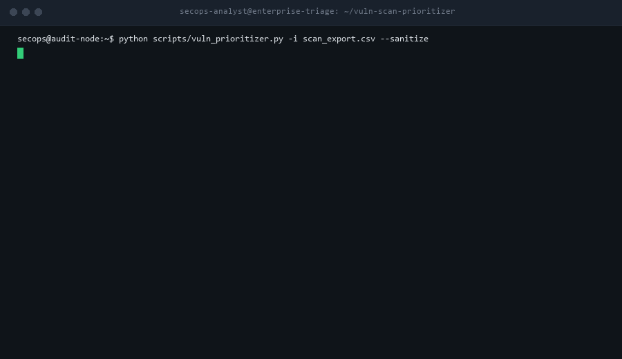

# Vulnerability Scan Prioritizer (`vuln-scan-prioritizer`)



[](https://github.com/ToritsejuBoyo/vuln-scan-prioritizer/actions/workflows/tests.yml)
[](LICENSE)
[]()
[-brightgreen.svg)](CONTRIBUTING.md)
[](SECURITY.md)
[](https://agentskills.io)

> An HD recording is available in [`assets/demo.mp4`](assets/demo.mp4).

Deterministic, offline vulnerability scan prioritizer and deduplication engine for **Tenable Nessus, Greenbone OpenVAS / GVM, Qualys VMDR, and Rapid7 Nexpose**. Ingests raw CSV exports, collapses repetitive multi-port findings into unified patch bundles, contextualizes risk via active threat intelligence (CISA KEV) and network exposure, and partitions issues into an actionable 4-wave remediation schedule with copy-paste ITSM patch tickets.

Zero third-party dependencies. Python standard library only.

---

## 1. Executive Summary & Stakeholder Briefing

### The One-Sentence Pitch
A zero-dependency security operations engine that transforms thousands of raw, noisy vulnerability scanner CSV rows into an exploit-aware, prioritized remediation roadmap and copy-paste patch tickets in seconds.

### The Real-World Problem
Enterprise vulnerability management teams, MSPs, and sysadmins face critical operational friction:
1. **The Tsunami of Raw Findings:** A single weekly scan across 100 enterprise servers routinely produces 5,000 to 15,000 un-deduplicated CSV rows. Security analysts spend days manually sorting Excel spreadsheets rather than remediating vulnerabilities.
2. **Context-Blind Static CVSS Scoring:** Vulnerability scanners rank findings solely by theoretical CVSS base scores. A theoretical CVSS 9.8 vulnerability on an isolated, air-gapped test VM is flagged as higher priority than a CVSS 7.5 Remote Code Execution (RCE) with an active CISA KEV in-the-wild exploit running on an internet-facing production portal.
3. **Duplicate Ticket Fatigue:** Scanners report findings separately for each network port and protocol. A single outdated OpenSSL library triggers 40 distinct line items across 40 network ports on one server, turning a 2-minute `apt-get upgrade openssl` package update into a 40-ticket operational nightmare.
4. **Data Privacy & Internal Network Leakage:** Raw scanner CSVs contain sensitive infrastructure telemetry (internal RFC 1918 IP addresses, Active Directory server names, exposed database ports, software versions). Uploading un-sanitized scan reports to cloud LLMs violates SOC 2, HIPAA, and ISO 27001 policies.

### The 3-Step Walkthrough
1. **Export Scanner CSV:** Export your standard scan report from Tenable Nessus, Greenbone OpenVAS, Qualys VMDR, or Rapid7 Nexpose.
2. **Execute Local Prioritizer:** Run `python scripts/vuln_prioritizer.py -i scan_export.csv --sanitize`. The tool deduplicates findings, clusters them by patchable package, cross-references active weaponized exploits (CISA KEV), and sanitizes all hostnames and internal IP addresses.
3. **Deploy Remediation Waves:** The tool outputs an executive Markdown assessment, a prioritized CSV action matrix, and pre-formatted Jira/ServiceNow patch tickets grouped into 4 execution waves (Emergency 24h, Urgent 7d, Standard 30d, Backlog/Info).

### Why IT Leadership Approves (CISO & VP of Infrastructure)
- **100% Read-Only & Offline:** Operates strictly offline on static CSV exports. Never initiates active network probes, port scans, or mutations against production infrastructure.
- **Client-Side Data Sanitization (Rule 4):** Automated `--sanitize` mode masks internal IPv4/IPv6 addresses (RFC 5737 `192.0.2.x`), internal server hostnames (`host-xxxx.corp.example.com`), and corporate domain suffixes before any summary leaves the machine or touches an LLM.
- **Zero Third-Party Dependencies (Rule 3):** Built 100% in pure Python standard library modules (`csv`, `json`, `re`, `argparse`, `dataclasses`, `pathlib`). No `pip install`, no compiled binaries, and zero alerts triggered on enterprise EDR solutions.
- **Measurable Risk Reduction (80/20 Rule):** Demonstrates to executive leadership how executing Wave 1 (Emergency) and Wave 2 (Urgent) remediates over 80% of real-world exploit risk with fewer than 15 unified patch bundles.

---

## 2. Why This Is Fundamentally Better Than What Exists

| Evaluation Dimension | Commercial VM Platforms (Tenable.io, Qualys) | Raw Excel Spreadsheet Filtering | Ad-Hoc LLM Prompting (ChatGPT, Claude) | What We Built (`vuln-scan-prioritizer`) |
| :--- | :--- | :--- | :--- | :--- |
| **Annual Cost** | \$30 - \$65+ per asset/year (\$30,000+/yr for 500 assets) | Free (manual labor) | Subscription fee | **100% Free & Open-Source (MIT)** |
| **Air-Gapped & Offline Usability** | No (requires SaaS cloud portal) | Yes | No (requires cloud connectivity) | **100% Offline (Local CLI & Air-Gapped Ready)** |
| **Data Privacy & Sanitization** | Ingests all internal IPs and hostnames | Manual redaction required | High risk of PII / IP data leakage | **Automated Client-Side RFC 5737 Sanitization** |
| **Noise & Multi-Port Deduplication** | Often alerts per port/interface | High manual pivot table effort | Inconsistent deduplication | **Deterministic Package-Level Aggregation** |
| **Threat Context Correlation** | Proprietary scoring models | Manual lookup | Prone to CVE hallucination | **Deterministic CISA KEV & Exploit Integration** |
| **Execution Speed** | Minutes to query complex dashboards | Hours of manual sorting | Rate limited by token context | **< 1 Second for 10,000 Findings** |

---

## 3. Architecture & Scoring Rubric

### The Contextual Risk Formula
$$\text{Composite Priority Score} = \text{CVSS Base} + \text{KEV Boost (3.0)} + \text{Exploit Boost (2.0)} + \text{Exposure Boost (2.0)} + \text{Criticality Boost (1.0)}$$

### 4 Remediation SLA Waves

```
+-------------------------------------------------------------------------+
|                        REMEDIATION SLA WAVES                            |
+-------------------------------------------------------------------------+
| Wave 1: Emergency (24h)   | Active CISA KEV or Score >= 12.0            |
| Wave 2: Urgent (7d)       | Base CVSS >= 9.0 or Score 9.0 - 11.9        |
| Wave 3: Standard (30d)    | Medium-to-High Internal (Score 5.0 - 8.9)   |
| Wave 4: Backlog / Info    | Informational / Low Severity (Score < 5.0)  |
+-------------------------------------------------------------------------+
```

---

## 4. Quick Start & Hands-On Testing

### Prerequisites
- Python 3.8 or higher.
- Zero external package installation (`pip install` is NOT required).

### Installation
Clone the repository:
```bash
git clone https://github.com/ToritsejuBoyo/vuln-scan-prioritizer.git
cd vuln-scan-prioritizer
```

### Ready-to-Run Test Walkthrough
Test against the bundled synthetic multi-scanner fixtures:

```bash
# 1. Nessus Enterprise Scan Triage (with sanitization and ticket export)
python scripts/vuln_prioritizer.py \
  -i tests/fixtures/fixture-nessus-enterprise-scan.csv \
  --sanitize \
  -o assessment_report.md \
  --generate-tickets itsm_tickets.md

# 2. OpenVAS / GVM Infrastructure Scan Triage
python scripts/vuln_prioritizer.py \
  -i tests/fixtures/fixture-openvas-infrastructure-scan.csv \
  --sanitize

# 3. Qualys VMDR Export Triage
python scripts/vuln_prioritizer.py \
  -i tests/fixtures/fixture-qualys-vmdr-scan.csv \
  --sanitize

# 4. Rapid7 Nexpose Export Triage
python scripts/vuln_prioritizer.py \
  -i tests/fixtures/fixture-rapid7-nexpose-scan.csv \
  --sanitize

# 5. Programmatic JSON Output Mode
python scripts/vuln_prioritizer.py \
  -i tests/fixtures/fixture-nessus-enterprise-scan.csv \
  --json
```

---

## 5. Verification Test Suite

Run the automated test harness:
```bash
# Run Standard Validation Harness (8 checks, exit code 0)
python tests/validate-skill.py

# Run Advanced Contextual Scoring & Edge Case Suite (5 checks)
python tests/advanced_scoring_test.py

# Run High-Volume 10,000-Row Stress Benchmark
python tests/stress_test_vuln_prioritizer.py

# Run Extreme & Adversarial ReDoS / Encoding Suite (6 checks)
python tests/extreme_test_vuln_prioritizer.py
```

---

## 6. Project Layout

```
vuln-scan-prioritizer/
├── .gitignore
├── LICENSE
├── README.md
├── SKILL.md
├── assets/
│   ├── demo.gif
│   ├── demo.mp4
│   ├── itsm-patch-ticket-template.md
│   └── vulnerability-remediation-report-template.md
├── build-tools/
│   ├── generate-demo-media.py
│   └── generate-fixtures.py
├── references/
│   ├── cisa-kev-catalog-reference.md
│   ├── contextual-risk-scoring-rubric.md
│   └── scanner-column-mapping-matrix.md
├── scripts/
│   └── vuln_prioritizer.py
└── tests/
    ├── advanced_scoring_test.py
    ├── extreme_test_vuln_prioritizer.py
    ├── stress_test_vuln_prioritizer.py
    ├── validate-skill.py
    └── fixtures/
        ├── fixture-cisa-kev.json
        ├── fixture-nessus-enterprise-scan.csv
        ├── fixture-openvas-infrastructure-scan.csv
        ├── fixture-qualys-vmdr-scan.csv
        └── fixture-rapid7-nexpose-scan.csv
```

---

## 7. License

MIT License. See [LICENSE](LICENSE) for full text.
